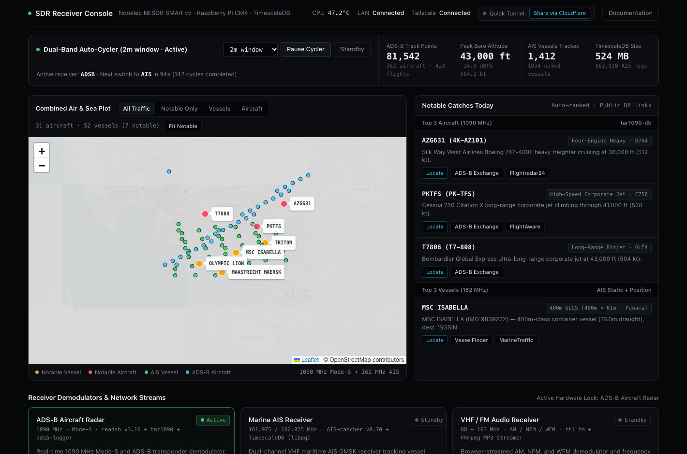
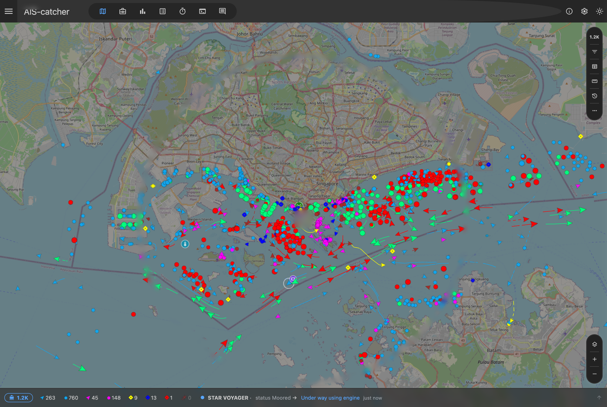
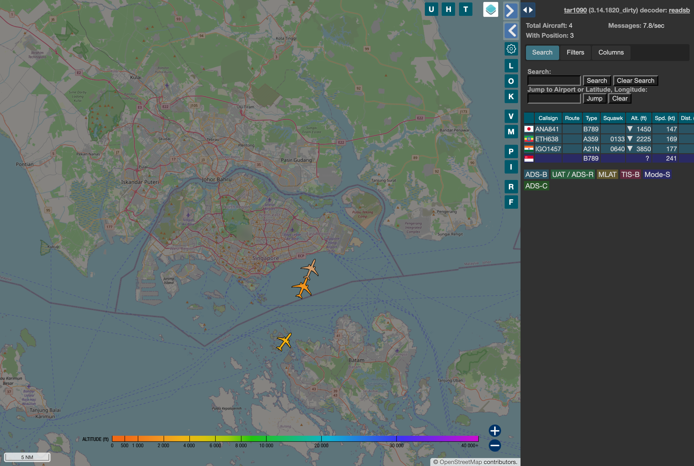
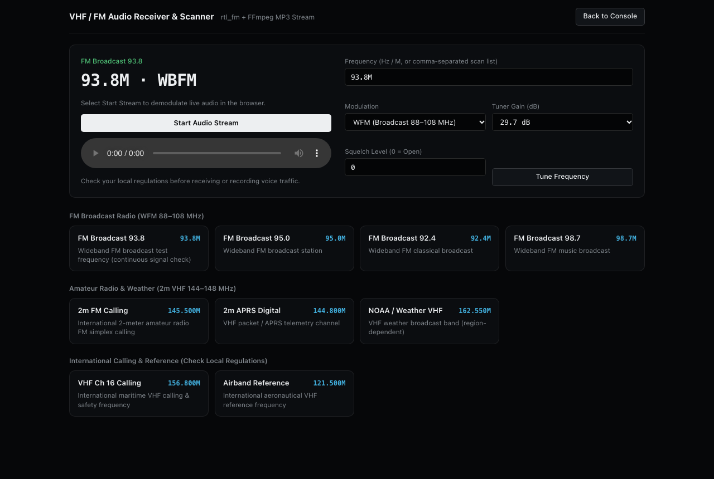
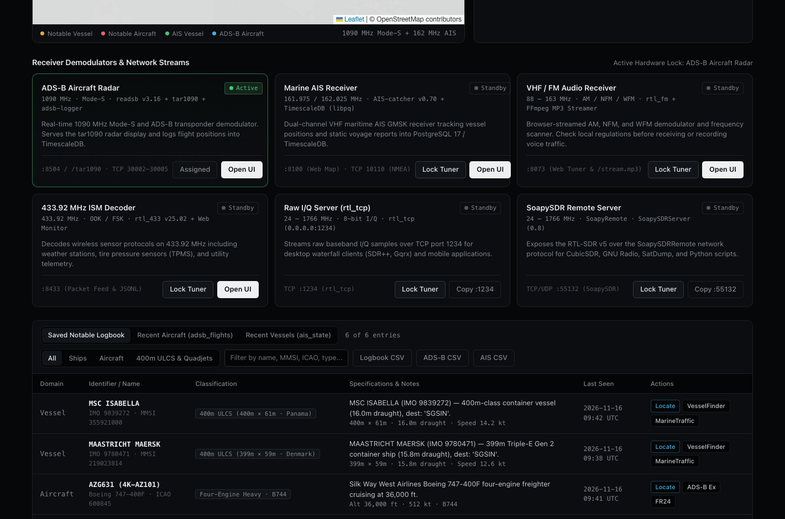

# Multi-Band SDR Radio Receiver Station

Built by Jan Smisek with Hermes Agent and Gemini.

This project configures a headless Raspberry Pi Compute Module 4 (or Raspberry Pi 4/5) and a single Nooelec NESDR SMArt v5 USB software-defined radio into a self-hosted receiver station for 1090 MHz ADS-B aircraft tracking, 162 MHz Marine AIS vessel tracking, VHF/FM browser audio demodulation, and 433.92 MHz ISM sensor telemetry.

It includes an automated ADS-B / Marine AIS dual-band cycler, a combined air and sea map, a persistent logbook of notable aircraft and vessels backed by PostgreSQL 17 and TimescaleDB, and Tailscale support for remote access.

Read the full technical build write-up in [`doc/README.md`](doc/README.md).



## Hardware

| Component | Model | Manufacturer Link | Notes |
|---|---|---|---|
| SDR Receiver & Antenna Kit | Nooelec NESDR SMArt v5 Bundle (100 kHz – 1.75 GHz, 3-Antenna Kit) | [Nooelec Store](https://www.nooelec.com/store/nesdr-smart.html) | RTL2832U + R820T2/R860 tuner with 0.5 PPM TCXO, aluminum enclosure, SMA input, magnetic base with 2 m RG-58 coaxial cable, and three interchangeable masts (variable-length telescopic VHF/UHF mast, fixed 1090 MHz UHF whip, and fixed 433 MHz ISM whip). |
| Single-Board Computer | Raspberry Pi Compute Module 4 (4 GB RAM, 16 GB eMMC) | [Raspberry Pi](https://www.raspberrypi.com/products/compute-module-4/) | Runs 64-bit Debian / Raspberry Pi OS headlessly under 5 W with PostgreSQL 17 and TimescaleDB. Any Raspberry Pi 4 or 5 also works. |

## Quick Start

1. Clone the repository onto your Raspberry Pi (Debian 12/13 or Raspberry Pi OS 64-bit):
   ```bash
   git clone https://github.com/smichpresel/sdr-station.git /opt/sdr-station
   cd /opt/sdr-station
   ```
2. Run the installer with your receiver coordinates:
   ```bash
   STATION_LAT="<your-lat>" STATION_LON="<your-lon>" STATION_NAME="<your-station-name>" ./install.sh
   ```
3. Open the web launcher:
   - LAN: `http://<your-pi-host>:8080/`
   - Tailscale: `http://<your-tailscale-host>:8080/`
   - Temporary Public Share Link (Cloudflare Quick Tunnel, no account required): Click **Share via Cloudflare** in the console top bar (or run `cloudflared tunnel --no-autoupdate --url http://127.0.0.1:8080`) to provision a temporary `https://<random-words>.trycloudflare.com` link on demand.

## Installed Services

| Service | Endpoint | Frequency Band | Description |
|---|---|---|---|
| Station Launcher & Map Hub | `http://<host>:8080/` | Control Plane | Mode switcher, dual-band ADS-B / AIS auto-cycler, combined air and sea map, notable catch logbook, and CSV export endpoints. |
| ADS-B Aircraft Radar (`readsb` + `tar1090`) | `http://<host>/tar1090/` (`:8504`) | 1090 MHz (Mode-S) | Real-time aviation radar interface with track history and continuous TimescaleDB hypertable logging (`adsb_positions`, `adsb_flights`). |
| Marine AIS Ship Radar (`AIS-catcher v0.70`) | `http://<host>:8100/` | 161.975 / 162.025 MHz | Dual-channel maritime VHF AIS decoder streaming vessel positions and static data into PostgreSQL 17 / TimescaleDB via `libpq`. |
| Browser Voice Receiver (`sdr-voice-web`) | `http://<host>:8073/` | 88 – 163 MHz (AM/NFM/WFM) | Browser-based MP3 audio demodulator and scanner using `rtl_fm` and `ffmpeg`. Check your local regulations before receiving or recording voice traffic. |
| ISM Sensor Decoder (`rtl-433-web`) | `http://<host>:8433/` | 433.92 MHz (ISM) | Decodes wireless weather stations, automotive tire pressure sensors (TPMS), and utility telemetry via `rtl_433`. |
| Remote Raw I/Q Server (`rtl_tcp` & `SoapyRemote`) | `<host>:1234` / `:55132` | 24 – 1766 MHz | Streams raw 8-bit I/Q samples over TCP for desktop SDR clients (SDR++, Gqrx, CubicSDR) and mobile clients. |

## Single-Dongle Multiplexing and Auto-Cycler

A single RTL-SDR USB tuner (`0bda:2838`) has one local oscillator and one ~2.4 MS/s baseband window, so only one demodulator process can claim the USB interface at a time.

To collect continuous datasets from both 1090 MHz ADS-B and 162 MHz Marine AIS without a second dongle, `DualBandCycler` in `launcher/launcher_server.py` alternates between `readsb.service` and `ais-catcher.service` on a configurable schedule (2 minutes per band by default; selectable between 1, 2, 3, 5, and 10 minutes). Because both services write to TimescaleDB, historical tables and the combined map remain available on port 8080 regardless of which receiver currently holds the tuner. Selecting Lock Mode on any individual service pauses the cycler and dedicates the hardware to that receiver.

## Combined Map and Notable Catch Logbook

1. Combined Air and Sea Map (`:8080`):
   - Plots recorded ADS-B aircraft and Marine AIS vessels on a single dark-themed OpenStreetMap view.
   - Highlights notable vessels and aircraft with distinct markers and labels, with filter controls for viewing all targets, notable catches only, ships only, or aircraft only.
2. Persistent Spotter Logbook (`spotter_highlights` in TimescaleDB):
   - Ranks aircraft (enriched against `wiedehopf/tar1090-db`) and vessels (by hull dimensions, draught, and vessel type) to surface the top 3 notable aircraft and top 3 notable vessels of the day, and stores notable catches in the `spotter_highlights` table so you can review them later or export them via `/api/highlights/export.csv`.
   - Includes direct lookup links to public databases: [ADS-B Exchange](https://globe.adsbexchange.com), [Planespotters.net](https://www.planespotters.net), [FlightRadar24](https://www.flightradar24.com), [VesselFinder](https://www.vesselfinder.com), [MarineTraffic](https://www.marinetraffic.com), and [MyShipTracking](https://www.myshiptracking.com).

## SQLite vs. TimescaleDB Benchmark

Measured on 22 hours of dual-band capture (863,203 AIS messages across 2,295 vessels and 22,469 ADS-B positions across 503 aircraft):

| Metric | Legacy SQLite (WAL) | PostgreSQL 17 + TimescaleDB 2.19 | Savings / Improvement |
|---|---|---|---|
| AIS Dataset Footprint (863k msgs / 2,295 ships) | `218.4 MB` (`215 MB` DB + `3.4 MB` WAL) | `77.4 MB` (`ais_archive_ts` hypertable + `ais_state`) | 64.6% smaller (`2.82x` reduction) |
| ADS-B Dataset Footprint (22.5k pts / 503 aircraft) | `8.0 MB` (`3.9 MB` DB + `4.1 MB` WAL) | `4.2 MB` (`adsb_positions` hypertable + `adsb_flights`) | 47.5% smaller (`1.90x` reduction) |
| Daily Disk Growth Rate (Raw Ingestion) | `~226 MB / day` (fills 6 GB eMMC in 26 days) | `~48 MB / day` (structured binary columns, `NMEA off`, 14d chunk retention) | 78.8% lower daily disk write rate |
| Long-Term Trajectory Rollup (`time_bucket('5m')`) | Not natively supported | `~5.8 MB / day` (`~1.6 GB / year`) | 97.3% reduction (3.5+ years capacity on 16 GB eMMC) |
| Dashboard Aggregation Query Latency | `~185 ms` (full B-tree table scan + file lock contention) | `~19 ms` (hypertable chunk exclusion + MVCC) | 9.7x faster concurrent reads |

## Limitations

- Single-tuner time-division multiplexing: With one RTL-SDR dongle, the station cannot receive 1090 MHz ADS-B and 162 MHz AIS at the exact same instant. When auto-cycling every 2 minutes, fast-moving aircraft or short transmissions occurring during the opposite window will not be captured unless a second USB dongle is added.
- Broadband whip antenna trade-offs: The included indoor whip antennas are convenient for multi-band experimentation, but reception range is limited by line-of-sight geometry, indoor multipath, and coax loss compared to roof-mounted band-specific collinear antennas and filtered LNAs.
- 8-bit ADC dynamic range: The RTL2832U uses an 8-bit ADC (~50 dB dynamic range), so strong nearby FM broadcast or paging transmitters can raise the noise floor on adjacent bands without external band-stop filtering.
- TimescaleDB Apache-2.0 edition: Debian's `postgresql-17-timescaledb` package provides the Apache-2.0 Community Edition, which supports hypertable chunking and retention policies (`drop_chunks`) but does not include Timescale License (TSL) columnar compression.

## Screenshots

| Marine AIS (`AIS-catcher` `:8100`) | ADS-B Radar (`tar1090` `/tar1090/`) |
|---|---|
|  |  |

| Browser Voice Receiver (`:8073`) | Notable Logbook & Analytics (`:8080`) |
|---|---|
|  |  |

## Repository Structure

```text
sdr-station/
├── LICENSE                            # MIT License
├── README.md                          # Project overview, benchmark & quick start
├── install.sh                         # Automated Raspberry Pi installer script
├── doc/
│   ├── README.md                      # Technical build notes (Markdown)
│   └── assets/                        # Station screenshots
├── launcher/
│   └── launcher_server.py             # Port 8080 Web Launcher, Auto-Cycler & Map Hub
├── adsb-analytics/
│   ├── adsb_logger.py                 # Background readsb -> TimescaleDB hypertable logger
│   └── adsb_analyze.py                # CLI & API analytics / tar1090-db enrichment
├── voice-receiver/
│   └── voice_server.py                # Port 8073 AM / NFM / WFM MP3 Web Tuner
├── ism-decoder/
│   └── ism_server.py                  # Port 8433 rtl_433 ISM sensor decoder UI
└── configs/
    ├── blacklist-rtlsdr.conf          # /etc/modprobe.d/blacklist-rtlsdr.conf
    ├── readsb.default                 # /etc/default/readsb template
    ├── adsb-logger.service            # systemd unit for ADS-B TimescaleDB logging
    ├── ais-catcher.service            # systemd unit for AIS-catcher v0.70 + TimescaleDB
    ├── sdr-voice-web.service          # systemd unit for Voice Receiver (:8073)
    ├── rtl-433-web.service            # systemd unit for 433.92 MHz ISM Decoder (:8433)
    ├── rtl-tcp.service                # systemd unit for Remote Raw I/Q Server (:1234)
    └── sdr-launcher.service           # systemd unit for Station Web Launcher (:8080)
```

## License

Released under the [MIT License](LICENSE).
