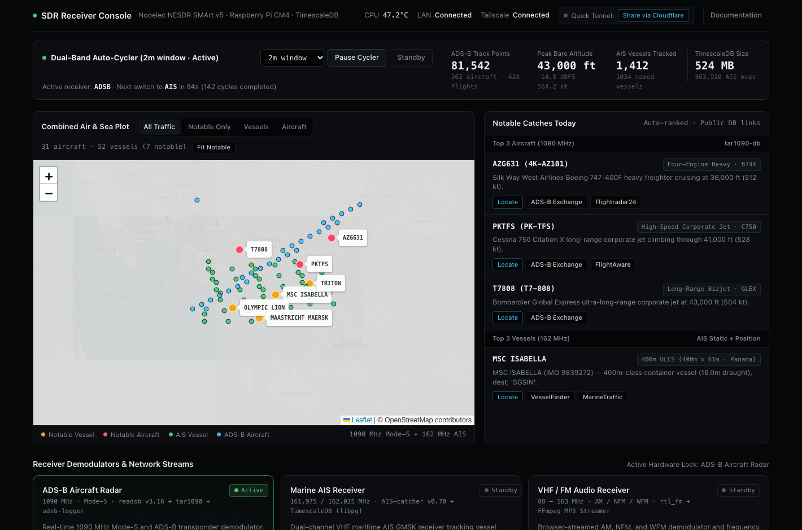
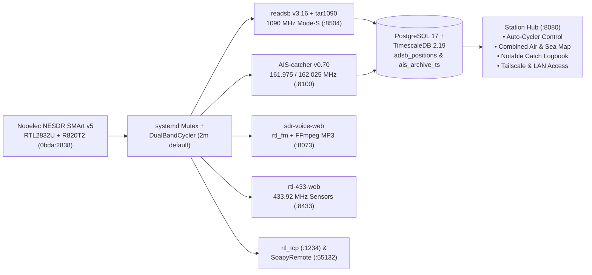
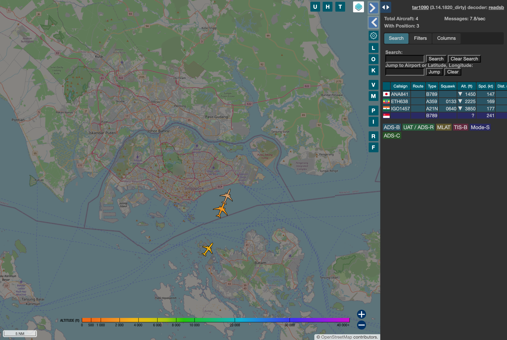
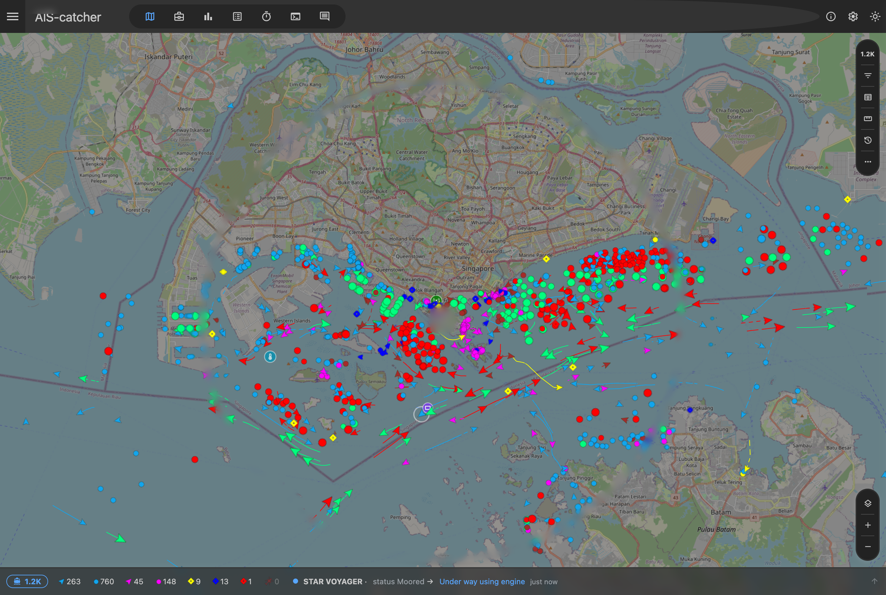
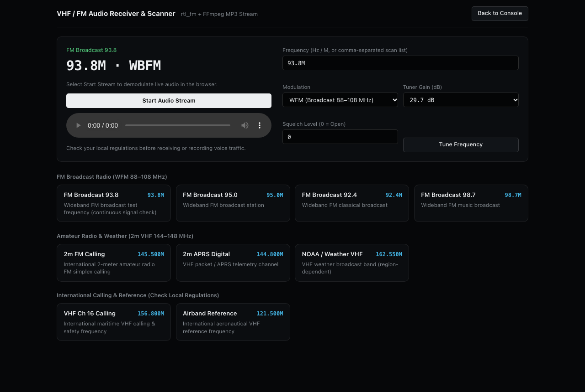
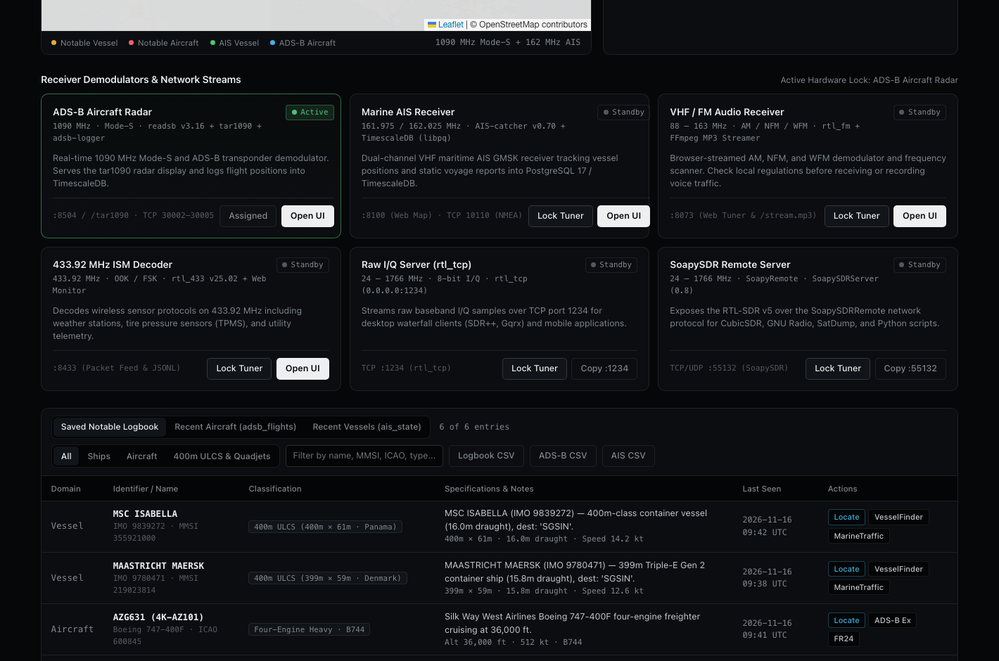

# Turning a Headless Raspberry Pi CM4 into a Multi-Band SDR Station

Built by Jan Smisek with Hermes Agent and Gemini.

This write-up documents how a headless Raspberry Pi Compute Module 4 and a single Nooelec NESDR SMArt v5 USB software-defined radio were configured over SSH into a multi-band receiver station for 1090 MHz ADS-B aircraft tracking, 162 MHz Marine AIS vessel tracking, browser-streamed VHF/FM audio, and 433.92 MHz ISM telemetry, backed by PostgreSQL 17 and TimescaleDB and accessible over Tailscale.



## Contents

1. [Hardware](#1-hardware)
2. [Build Approach](#2-build-approach)
3. [Single-Dongle Constraint and System Architecture](#3-single-dongle-constraint-and-system-architecture)
4. [Step-by-Step Setup and Troubleshooting](#4-step-by-step-setup-and-troubleshooting)
5. [ADS-B Radar and Flight Telemetry](#5-ads-b-radar-and-flight-telemetry)
6. [Marine AIS Vessel Reception](#6-marine-ais-vessel-reception)
7. [Browser Audio Demodulator](#7-browser-audio-demodulator)
8. [Dual-Band Auto-Cycler, Combined Map, and TimescaleDB Benchmarks](#8-dual-band-auto-cycler-combined-map-and-timescaledb-benchmarks)
9. [Limitations](#9-limitations)

---

## 1. Hardware

The station runs on a headless Raspberry Pi Compute Module 4 connected to a Nooelec NESDR SMArt v5 kit with three interchangeable antennas:

| Component | Model | Manufacturer Link | Notes |
|---|---|---|---|
| SDR Receiver & Antenna Kit | Nooelec NESDR SMArt v5 Bundle (100 kHz – 1.75 GHz, SKU 100700) | [Nooelec Store](https://www.nooelec.com/store/nesdr-smart.html) | Includes the NESDR SMArt v5 (`RTL2832U` + `R820T2/R860` tuner, `0.5 PPM` TCXO, female SMA input), a magnetic base with a 2 m RG-58 cable, and three antenna masts: a telescopic VHF/UHF mast, a fixed 1090 MHz UHF whip, and a fixed 433 MHz ISM whip. |
| Single-Board Computer | Raspberry Pi Compute Module 4 (4 GB RAM, 16 GB eMMC) | [Raspberry Pi](https://www.raspberrypi.com/products/compute-module-4/) | Runs 64-bit Debian 13 (`aarch64`) headlessly under 5 W while running `readsb`, `AIS-catcher`, and PostgreSQL 17 + TimescaleDB. |

---

## 2. Build Approach

The goal was to provision a newly flashed, headless Raspberry Pi Compute Module 4 with an attached RTL-SDR v5 dongle into a self-contained radio receiver appliance without manual configuration on the host. Given SSH key access and passwordless `sudo`, Hermes Agent inspected the hardware over SSH, blacklisted conflicting DVB kernel modules, compiled the C/C++ decoders (`readsb` and `AIS-catcher`) with hardware and PostgreSQL support enabled, set up systemd units with hardware mutual exclusion, migrated telemetry storage from SQLite to TimescaleDB hypertables, and packaged the configuration and web control plane into a reproducible Git repository.

Over the first 22 hours of dual-band operation, the station recorded:

| Metric | Recorded Value | Notes |
|---|---|---|
| Marine AIS Vessels | 2,295 vessels | 863,203 AIS messages decoded on 161.975 / 162.025 MHz |
| ADS-B Aircraft | 503 aircraft | 22,469 Mode-S / ADS-B position records logged on 1090 MHz |
| Database Footprint | 81.6 MB (TimescaleDB) | Down from 226.4 MB in SQLite (64.6% smaller, 9.7x faster queries) |

---

## 3. Single-Dongle Constraint and System Architecture

Running `lsusb` and `rtl_test` on the CM4 confirmed the USB device enumeration:

```text
Bus 001 Device 003: ID 0bda:2838 Realtek Semiconductor Corp. RTL2838 DVB-T
Found 1 device(s):
  0:  Nooelec, NESDR SMArt v5
Using device 0: Generic RTL2832U OEM
Found Rafael Micro R820T tuner
```

The NESDR SMArt v5 tunes from roughly 100 kHz to 1.75 GHz, covering FM broadcast (88–108 MHz), VHF aviation and marine bands, 433.92 MHz ISM sensors, and 1090 MHz Mode-S transponders.

However, a single USB SDR dongle has one local oscillator and one ~2.4 MS/s ADC baseband window. It cannot simultaneously tune 1090 MHz for ADS-B and 162 MHz for Marine AIS. If two processes attempt to claim `usb:0bda:2838` at the same time, the second process fails with `usb_claim_interface error -6 (LIBUSB_ERROR_BUSY)`.

To support multiple bands with one tuner, radio hardware ownership is decoupled from the web and database layer:



| Receiver Mode | Systemd Unit | Frequency / Modulation | Port / Endpoint |
|---|---|---|---|
| Station Launcher & Map Hub | `sdr-launcher.service` | Control Plane (Always On) | `:8080` |
| ADS-B Aircraft Radar | `readsb.service` + `tar1090` | 1090 MHz Mode-S | `/tar1090/`, `:8504`, TCP `30002-30005` |
| Marine AIS Ship Radar | `ais-catcher.service` | 161.975 & 162.025 MHz GMSK | `:8100` (Web Map), TCP `10110` (NMEA) |
| VHF / FM Voice Receiver | `sdr-voice-web.service` | 88–163 MHz (AM / NFM / WFM) | `:8073` (Web Tuner & `/stream.mp3`) |
| ISM Sensor Decoder | `rtl-433-web.service` | 433.92 MHz (OOK / FSK) | `:8433` (Live Packet & Device Table) |
| Remote Raw I/Q Server | `rtl-tcp.service` / `soapy` | 24–1766 MHz Raw I/Q | TCP `:1234` (SDR++) / `:55132` (Soapy) |

---

## 4. Step-by-Step Setup and Troubleshooting

### Step 1: Blacklisting DVB-T Kernel Modules

Because the RTL2832U chip was originally designed as a DVB-T television demodulator, Linux loads `dvb_usb_rtl28xxu`, `rtl2832`, and `rtl2832_sdr` by default when the dongle is inserted. Blacklisting those modules in `/etc/modprobe.d/blacklist-rtlsdr.conf` and unloading them allows `librtlsdr` to claim the USB interface:

```bash
cat << 'EOF' | sudo tee /etc/modprobe.d/blacklist-rtlsdr.conf
blacklist dvb_usb_rtl28xxu
blacklist rtl2832
blacklist rtl2832_sdr
blacklist dvb_usb_v2
blacklist dvb_core
EOF
sudo rmmod rtl2832_sdr dvb_usb_rtl28xxu rtl2832 dvb_usb_v2 dvb_core
```

### Step 2: Staging Source Archives over LAN

The CM4's wireless link was associated at `-72 dBm`, making large upstream clones slow directly on the board. Upstream repositories (`wiedehopf/readsb`, `wiedehopf/tar1090-db`, and `jvde-github/AIS-catcher`) were fetched on the workstation, packed without `.git` history, and transferred over the local network via `scp` and `rsync`.

### Step 3: Compiling `readsb` with `RTLSDR=yes`

Debian 13 packages a `readsb` binary in `apt`, but it is compiled without `RTLSDR=yes` and exits immediately when configured with `--device-type rtlsdr`:

```text
readsb: SDR type '0' not recognized; supported SDR types are:
  modesbeast
  gnshulc
  ifile
  none
ERROR: Unknown device type: 0
```

Compiling `wiedehopf/readsb` (`v3.16.21`) from source with `make -j4 RTLSDR=yes` (`-DENABLE_RTLSDR`) and installing the resulting binary into `/usr/bin/readsb` resolved the issue. Paired with `tar1090` under `lighttpd`, it began decoding Mode-S frames immediately.

---

## 5. ADS-B Radar and Flight Telemetry

`readsb` writes live aircraft state to a `tmpfs` RAM disk at `/run/readsb/aircraft.json` once per second to avoid eMMC flash wear.



A background service (`adsb-logger.service` running `adsb_logger.py`) polls `/run/readsb/aircraft.json`, deduplicates Mode-S message counts per ICAO hex, optionally calculates Haversine distance and bearing when `STATION_LAT` and `STATION_LON` are set in `/etc/default/sdr-station`, and inserts records into PostgreSQL 17 / TimescaleDB hypertables (`adsb_positions` and `adsb_flights`).

---

## 6. Marine AIS Vessel Reception

To decode Marine AIS on 161.975 MHz (AIS1 / Channel 87B) and 162.025 MHz (AIS2 / Channel 88B), `AIS-catcher v0.70` was compiled from source with `librtlsdr`, `libpq` (PostgreSQL), `openssl`, and `zlib`.

In `AIS-catcher v0.70`, the `-D postgresql:///sdr_station` output driver requires explicitly enabling table writers on the command line (`POSITION on STATIC on STATE on STATS on NMEA off INTERVAL 10 RETENTION 14`). Once started, the dual-channel GMSK demodulator sustained over 17 messages per second:

```text
Device    : NESDR SMArt v5
Settings  : rate 1536K format CU8 tuner AUTO rtlagc ON biastee OFF
[AIS engine v1 base #0-0] received: 176 msgs, total: 176 msgs, rate: 17.2911 msg/s
```



---

## 7. Browser Audio Demodulator

To demodulate analog audio in a browser without installing desktop SDR software on each client, `voice-receiver/voice_server.py` (`sdr-voice-web.service`) serves a web tuner on port 8073. When a client connects to `/stream.mp3`, the service spawns an on-demand `rtl_fm` pipeline feeding `ffmpeg` (`libmp3lame` with bandpass filtering for narrowband voice and de-emphasis for wideband FM) and streams HTTP MP3 audio to a standard HTML5 `<audio>` element.

Check your local regulations before receiving or recording voice traffic.



For wideband waterfall inspection in desktop clients such as SDR++ or Gqrx, the launcher can switch the hardware to `rtl_tcp` mode on TCP port 1234.

---

## 8. Dual-Band Auto-Cycler, Combined Map, and TimescaleDB Benchmarks

The main station portal on port 8080 (`launcher/launcher_server.py`) coordinates the receivers and queries TimescaleDB:

- Selectable ADS-B / Marine AIS Auto-Cycler: `DualBandCycler` alternates the RTL-SDR v5 between `readsb.service` (1090 MHz) and `ais-catcher.service` (162 MHz) every 2 minutes by default (configurable to 1, 2, 3, 5, or 10 minutes).
- Account-Free Cloudflare Quick Tunnel (`cloudflared`): `CloudflareTunnelManager` in `launcher/launcher_server.py` wraps `cloudflared tunnel --no-autoupdate --url http://127.0.0.1:8080` (`POST /api/tunnel`). Clicking **Share via Cloudflare** in the top bar spawns a temporary `https://<random-words>.trycloudflare.com` URL in ~4 seconds without requiring a Cloudflare account, login, or domain.
- Modern Web Console UI: Styled with CSS Cascade Layers (`@layer`), OKLCH color tokens, CSS `subgrid` receiver cards, tabular monospace telemetry readouts (`font-variant-numeric: tabular-nums`), and segmented controls following [GoogleChrome/modern-web-guidance](https://github.com/GoogleChrome/modern-web-guidance) and [benjitaylor/skills (`stageshow`)](https://github.com/benjitaylor/skills).
- Combined Air and Sea Map: Renders both recorded ADS-B aircraft and Marine AIS vessels on a single Leaflet map with filter toggles (`All Traffic`, `Notable Only`, `Vessels`, `Aircraft`).
- Notable Catches and Persistent Logbook (`spotter_highlights`): Enriches aircraft ICAO hex codes against `wiedehopf/tar1090-db` and scores vessels by hull dimensions, draught, and vessel type (such as 400 m ultra-large container ships, deep-draught tankers, four-engine widebody aircraft, and long-range corporate jets). Notable catches are persisted in the `spotter_highlights` table with links to ADS-B Exchange, Planespotters.net, FlightRadar24, VesselFinder, MarineTraffic, and MyShipTracking.

### SQLite vs. TimescaleDB Storage and Query Benchmark

Over 22 hours of dual-band capture (863,203 AIS messages across 2,295 vessels and 22,469 ADS-B positions across 503 aircraft), raw SQLite storage reached 226.4 MB (`218.4 MB` AIS + `8.0 MB` ADS-B). Migrating to TimescaleDB hypertables (`adsb_positions` and `ais_archive_ts`) with typed binary columns, `NMEA off`, and 14-day chunk retention reduced total database size to 81.6 MB immediately:

| Metric | Legacy SQLite (WAL) | PostgreSQL 17 + TimescaleDB 2.19 | Savings / Improvement |
|---|---|---|---|
| AIS Dataset Footprint (863k msgs / 2,295 ships) | `218.4 MB` (`215 MB` DB + `3.4 MB` WAL) | `77.4 MB` (`ais_archive_ts` hypertable + `ais_state`) | 64.6% smaller (`2.82x` reduction) |
| ADS-B Dataset Footprint (22.5k pts / 503 aircraft) | `8.0 MB` (`3.9 MB` DB + `4.1 MB` WAL) | `4.2 MB` (`adsb_positions` hypertable + `adsb_flights`) | 47.5% smaller (`1.90x` reduction) |
| Daily Disk Growth Rate (Raw Ingestion) | `~226 MB / day` (fills 6 GB eMMC in 26 days) | `~48 MB / day` (structured binary columns, `NMEA off`, 14d chunk retention) | 78.8% lower daily disk write rate |
| Long-Term Trajectory Rollup (`time_bucket('5m')`) | Not natively supported | `~5.8 MB / day` (`~1.6 GB / year`) | 97.3% reduction (3.5+ years capacity on 16 GB eMMC) |
| Dashboard Aggregation Query Latency | `~185 ms` (full B-tree table scan + file lock contention) | `~19 ms` (hypertable chunk exclusion + MVCC) | 9.7x faster concurrent reads |



---

## 9. Limitations

- Single-tuner time-division multiplexing: Because a single RTL-SDR dongle can only tune one frequency band at a time, cycling between 1090 MHz and 162 MHz samples each band for 2 minutes out of every 4-minute window. Continuous simultaneous reception requires a second RTL-SDR dongle.
- Antenna placement and coax loss: The bundled indoor whip antennas are convenient for portable or window-sill use, but VHF/UHF reception is line-of-sight limited. Roof-mounted collinear antennas and short low-loss coax significantly improve range.
- 8-bit ADC dynamic range: Strong nearby transmitters can overload the RTL2832U front end without external band-pass or FM notch filtering.
- TimescaleDB Community Edition licensing: Debian's packaged `postgresql-17-timescaledb` uses the Apache-2.0 license, which provides hypertables and chunk retention policies but excludes TSL columnar compression.
